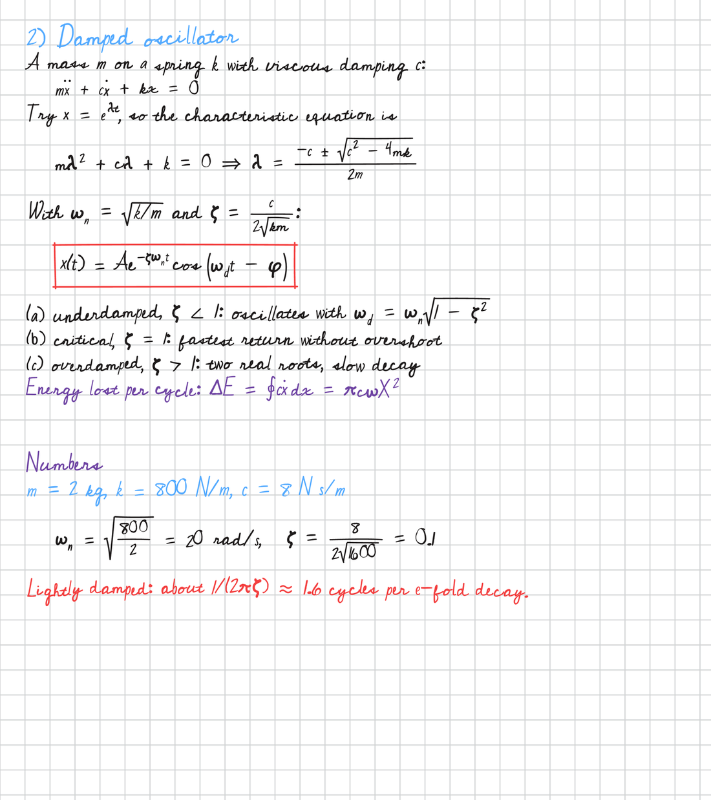
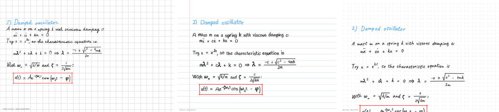
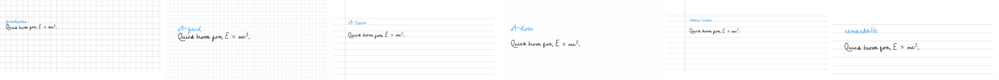
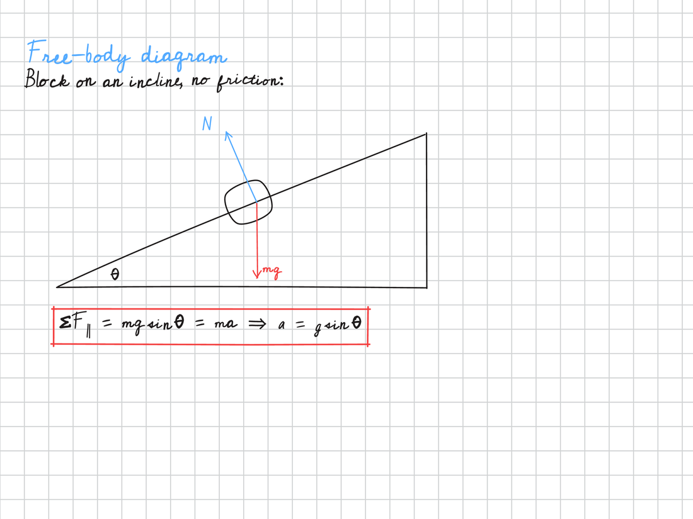
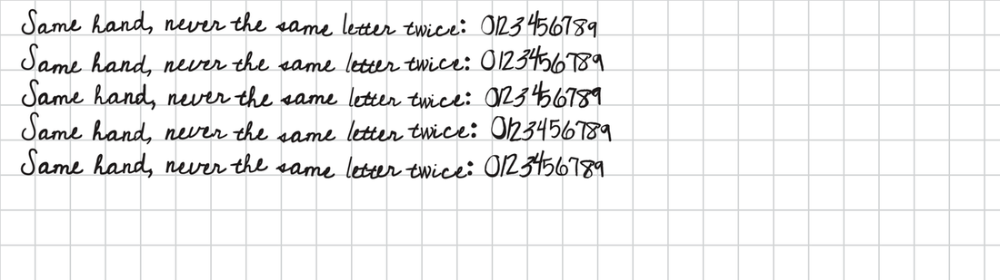

<div align="center">

# penpad

**Turn typed notes into realistic handwritten pages: Markdown and LaTeX math in, PDF or PNG out.**
Made for reading and studying on a tablet (iPad with Goodnotes or Notability, reMarkable,
Kindle Scribe, Boox) and for printing.

[](https://github.com/felipefrf/penpad/actions/workflows/ci.yml)




</div>

penpad is a text-to-handwriting generator that handles math. You write notes in Markdown with
`$LaTeX$`, and it lays them out on a notebook page the way a person would write them: fractions,
integrals, roots, vectors, Greek letters, boxed results and colored pens. No two letters come out
identical, and the writing still reads as one consistent hand.

- **Math in handwriting.** It understands a practical subset of LaTeX: `\frac`, `\int_a^b`,
  `\sqrt`, `\vec`, `\hat`, `\dot`, `\left( \right)`, Greek letters, `\partial`, `\nabla` and more.
- **Believable variation.** Slant, size and baseline drift slowly, like a real hand. Each letter
  has a small repertoire of shapes and the same shape never appears twice in a row. A legibility
  clamp keeps every letter readable ([how it works](#how-the-handwriting-varies)).
- **Tablet-ready pages.** Paper presets for the Goodnotes default page, A4 or US Letter (grid,
  lined, dotted or plain) and reMarkable. The PDF comes out at the real page size, ready to import.
- **Installs anywhere.** Pure `pip` dependencies (resvg, Pillow, fontTools) with bundled
  open-source fonts. No Cairo, no LaTeX install, no browser, no API key, no network access.
  Tested on Linux, macOS and Windows.
- **Reproducible.** The same seed gives the same page, pixel for pixel.

## Quick start

```bash
pip install "git+https://github.com/felipefrf/penpad"
penpad demo                      # writes penpad-demo.pdf
penpad render notes.md           # writes notes.pdf
```

No install with [uv](https://docs.astral.sh/uv/):

```bash
uvx --from git+https://github.com/felipefrf/penpad penpad render notes.md
```

Docker:

```bash
docker build -t penpad https://github.com/felipefrf/penpad.git
docker run --rm -v "$PWD:/work" penpad render notes.md
```

## Writing notes

```markdown
# 2) Damped oscillator
A mass $m$ on a spring $k$ with viscous damping $c$:
$$ m\ddot{x} + c\dot{x} + kx = 0 $$
$$! x(t) = A e^{-\zeta\omega_n t} \cos\left(\omega_d t - \phi\right) $$
(a) underdamped, $\zeta < 1$: oscillates with $\omega_d = \omega_n\sqrt{1 - \zeta^2}$
> Energy lost per cycle: $\Delta E = \pi c \omega X^2$
{red} Lightly damped: about $1/(2\pi\zeta) \approx 1.6$ cycles per e-fold decay.
```

| Line | Result |
|---|---|
| `# Title` | title in the accent pen (blue) |
| `## Heading` | heading in purple |
| text with `$...$` | paragraph with inline math, wrapped to the page |
| `$$ ... $$` | equation on its own line, shrunk to fit if it is too wide |
| `$$! ... $$` | boxed result |
| `- item`, `(a) item`, `1. item` | list item with hanging indent |
| `> note` | side note in purple |
| `{red} line` | pen color for that line: black, blue, red, purple, green, gray or `#hex` |
| `---` | new page |

A full example is in [`examples/physics-notes.md`](examples/physics-notes.md).

## Command line

```text
penpad render notes.md [-o out.pdf|out.png] [--style cursive|print|casual]
              [--paper goodnotes|a4-grid|a4-lines|a4-dots|a4-blank|letter-lines|letter-grid|remarkable]
              [--seed N] [--jitter 0.7] [--slant 4] [--footer "Physics I"] [--dpi 225] [-j JOBS]
penpad list                      # styles, inks and papers
penpad calibrate my_page.pdf     # compare a page you wrote with the bundled fonts
cat notes.md | penpad render - -o notes.pdf
```

Pages render in parallel (`-j`, all cores by default), so long documents scale with the machine.
Output is one line per file, and errors are a single line too (`-v` shows the details).

## Styles and papers





## Python API

```python
from penpad import Notebook

nb = Notebook(paper="goodnotes", style="cursive", seed=21)
nb.title("Free-body diagram")
nb.text("Block on an incline, no friction:")

def incline(nb, x0, y0):
    nb.line(x0 + 40, y0 + 230, x0 + 520, y0 + 230)
    nb.line(x0 + 40, y0 + 230, x0 + 520, y0 + 30)
    nb.arrow(x0 + 300, y0 + 120, x0 + 300, y0 + 220, color="red")
    nb.write(x0 + 308, y0 + 214, "mg", color="red")

nb.figure(260, incline)
nb.math(r"\sum F_{\parallel} = mg\sin\theta = ma \Rightarrow a = g\sin\theta", box=True)
nb.save("incline.pdf")          # or .png, one file per page
```



`Notebook` also has `heading`, `eq` (penpad's compact markup: `\f{a}{b}`, `x_1`, `\i{0}{1}`),
`curve`, `circle`, `space` and `page_break`. Any style key can be overridden:
`Notebook(style="cursive", jitter=0.9, slant=6, allographs=6)`. Use `register_font("Mine", "mine.ttf")`
and `font="Mine"` to write with your own handwriting font.

## How the handwriting varies



Font-based generators usually either repeat the same glyph or jitter every letter independently,
which looks mechanical. penpad models a writer in three layers.

1. **Writer state.** Slant, rotation, size and baseline follow mean-reverting random processes
   (Ornstein–Uhlenbeck). Neighbouring letters lean and float together, and the line wanders and
   comes back.
2. **Allographs.** Each character gets a fixed repertoire of shapes (4 by default) derived from the
   seed. The writer always draws an "a" in one of their four ways and never uses the same one twice
   in a row.
3. **Instance noise.** Every use redraws part of the outline deformation, so no two letters are
   pixel-identical.

Some rules keep it legible:

- Rotation, skew and scale are clamped.
- Letters that become ambiguous in a font are pinned to a clearer one. In the cursive style p
  would read as ρ, w as ω, b as ℓ, l as e, and a lone C as "(".
- Letters borrowed from another font are scaled to the main font's x-height.
- Symbols that fonts draw badly (→ ⇒ ∇ ∫ ∮ ≠ ≈ √ and the math accents) are drawn stroke by stroke.

The test suite checks all of this: determinism, character coverage, that every glyph leaves ink,
the clamps, the no-repeat rule and the correlation of the slant.

## Calibrating to your own handwriting

Export a page you wrote from Goodnotes (or any app) as PDF and run:

```bash
pip install "penpad[calibrate] @ git+https://github.com/felipefrf/penpad"
penpad calibrate my_page.pdf --out calibration
```

`calibration/measures.json` holds your page size, paper and grid colors and pen colors.
`calibration/comparison.png` shows a strip of your page above the same phrase in every bundled
font. Pick the closest one, then tune `jitter`, `slant` and `pressure`.

## FAQ

**How do I get the notes into Goodnotes, Notability or a reMarkable?** Import the PDF. The default
`goodnotes` paper matches the Goodnotes page size and grid, so imported pages line up with new
pages you write by hand.

**Does it need LaTeX installed?** No. penpad reads LaTeX math syntax and draws it itself.

**Can I use my own handwriting?** Yes, with any handwriting font. Turn your writing into a font
(for example with Calligraphr), then load it with `register_font`.

**Is it deterministic?** Yes. Change `--seed` for a different hand, keep it for identical output.

## Intended use

penpad is for your own study notes, tablet notebooks, flashcards, mockups, comics and design work.
Do not use it to pass generated text off as handwriting where handwriting is required, such as
exams, signatures or handwritten assignments.

## Credits

The bundled fonts keep their own licenses, in [`src/penpad/fonts/licenses`](src/penpad/fonts/licenses):

| Font | Designer | License |
|---|---|---|
| Cedarville Cursive | Kimberly Geswein | OFL |
| Bad Script | Roman Shchyukin (Gaslight) | OFL |
| Handlee | Joe Prince | OFL |
| Caveat | Pablo Impallari | OFL |
| Gochi Hand | Juan Pablo del Peral | OFL |
| Walter Turncoat | Squid (Font Diner / Sideshow) | Apache 2.0 |
| Virgil | Ellinor Rapp (Excalidraw) | OFL |
| Mynerve | Carolina Short | OFL |

Code under the MIT license. Leia em português: [README.pt-BR.md](README.pt-BR.md).
