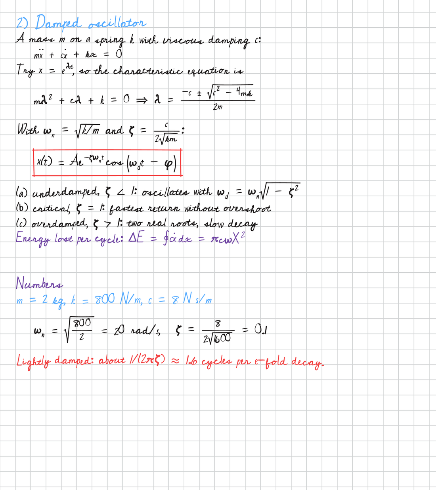

# penpad

**Transforma anotações digitadas em páginas manuscritas realistas. Entra Markdown com fórmulas
em LaTeX e sai PDF ou PNG**, pronto para estudar no tablet (iPad com Goodnotes ou Notability,
reMarkable, Kindle Scribe, Boox) ou para imprimir.



O penpad é um gerador de letra à mão que entende matemática. Você escreve em Markdown com
`$LaTeX$`, e ele monta a página como uma pessoa escreveria no caderno, com frações, integrais,
raízes, vetores, letras gregas, resultado em caixa e canetas coloridas. Duas letras nunca saem
iguais, mas a escrita continua parecendo de uma mão só.

## Instalação

```bash
pip install "git+https://github.com/felipefrf/penpad"
penpad demo                 # gera penpad-demo.pdf
penpad render notas.md      # gera notas.pdf
```

Não precisa de Cairo, LaTeX, navegador, chave de API nem internet. As dependências vêm todas do
pip, e as fontes livres já vêm no pacote. Funciona em Linux, macOS e Windows. Também roda via
`uvx --from git+https://github.com/felipefrf/penpad penpad ...` ou Docker (veja o README em inglês).

## Formato das notas

| Linha | Resultado |
|---|---|
| `# Título` | título em azul |
| `## Seção` | seção em roxo |
| texto com `$...$` | parágrafo com fórmula no meio do texto |
| `$$ ... $$` | equação em linha própria, que diminui se não couber |
| `$$! ... $$` | resultado dentro de caixa |
| `- item`, `(a) item`, `1. item` | item com recuo |
| `> nota` | observação em roxo |
| `{red} linha` | cor da caneta da linha (black, blue, red, purple, green, gray ou `#hex`) |
| `---` | nova página |

Papéis disponíveis: página padrão do Goodnotes, A4 quadriculado, pautado, pontilhado ou liso,
Carta pautado ou quadriculado e reMarkable. Estilos de letra: `cursive`, `print` e `casual`.

## Por que a letra parece de verdade

A inclinação, o tamanho e a linha de base mudam devagar, como numa mão de verdade (processos de
Ornstein–Uhlenbeck). Cada letra tem um repertório fixo de formas e nunca repete a mesma em
sequência, e cada uso ainda redesenha um pouco o contorno. Limites de rotação e escala, a troca
de letras ambíguas (p/ρ, w/ω, b/ℓ) e símbolos desenhados a traço garantem a leitura. Com a mesma
`--seed`, o resultado é idêntico.

## Uso responsável

O penpad serve para anotações de estudo, cadernos no tablet, flashcards, mockups e design. Não o
use para apresentar texto gerado como se fosse manuscrito onde a escrita à mão é exigida, como em
provas, assinaturas ou trabalhos que pedem entrega manuscrita.

Documentação completa, API em Python e créditos das fontes estão no [README em inglês](README.md).
